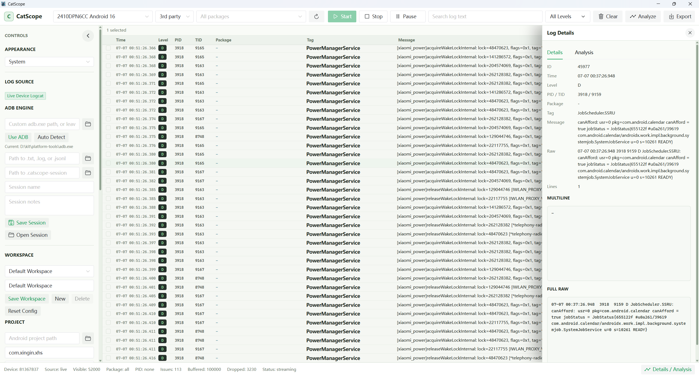
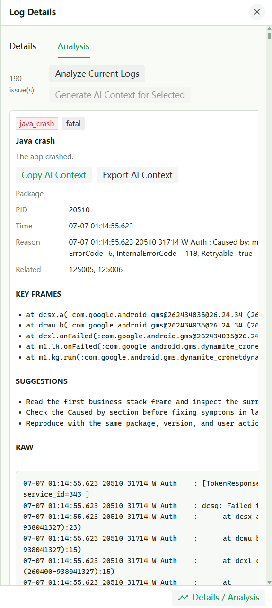
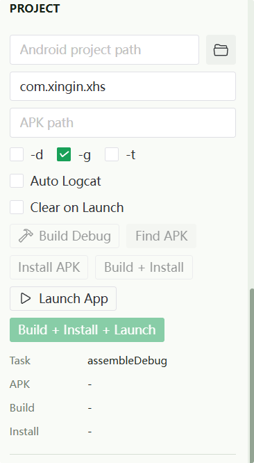
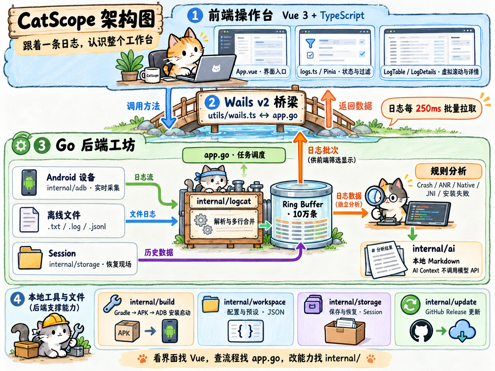

<p align="center">
  
</p>

<h1 align="center">CatScope</h1>

<p align="center">轻量级 Android Logcat 调试工作台</p>

<p align="center">
  <a href="https://github.com/HBLADEH/CatScope/releases"></a>
  <a href="./LICENSE"></a>
</p>

<p align="center">
  <a href="./README.md">English</a> · 简体中文
</p>

<p align="center">
  <a href="#下载安装">下载安装</a> ·
  <a href="#快速上手">快速上手</a> ·
  <a href="#架构">架构</a> ·
  <a href="#开发">开发</a> ·
  <a href="#文档">文档</a>
</p>

CatScope 用于查看 Android 实时和离线 Logcat，筛选应用日志、分析 Crash 与 ANR，并保存可恢复的调试会话。



<details>
<summary>更多截图：问题分析与构建安装</summary>

| 问题分析 | 构建、安装与启动 |
| --- | --- |
|  |  |

</details>

## 功能

- **日志查看**：实时 ADB Logcat，以及 `.txt`、`.log`、`.jsonl` 离线文件；虚拟滚动日志列表。
- **搜索过滤**：包名与 PID 追踪、level、tag、关键词、排除词和正则表达式。
- **问题分析**：用本地规则识别 Java Crash、ANR、native crash、JNI error 和安装失败。
- **AI Context**：将分析结果与相关日志整理为 Markdown，支持复制和导出。
- **会话与预设**：通过 `.catscope-session` 保存和恢复日志、过滤条件与分析结果；用 workspace 和过滤预设复用配置。
- **构建安装启动**：调用项目的 Gradle Wrapper（默认 `assembleDebug`），安装 APK 并启动指定应用。

功能边界与当前限制见 [已知问题](./docs/KNOWN_ISSUES.md)。

## 下载安装

从 [GitHub Releases](https://github.com/HBLADEH/CatScope/releases) 下载对应平台的文件。项目目前处于 Preview 阶段。

| 平台 | 文件 | 安装方式 |
| --- | --- | --- |
| Windows 10 / 11（x64） | `*-windows-amd64.exe` | 直接运行，需要 [Microsoft WebView2 Runtime](https://developer.microsoft.com/microsoft-edge/webview2/) |
| macOS（Intel / Apple Silicon，预览版） | `*-macos-universal.dmg` | 打开 DMG，将 CatScope 拖入 Applications |

macOS 版本尚未经过 Apple notarization，首次启动可能被 Gatekeeper 拦截。确认下载来源后，可在“系统设置 → 隐私与安全性”中允许打开。Linux 暂无官方发行包。

Windows 支持在 EXE 所在目录可写时校验更新并重启；macOS 需手动更新。发行包均附带 `.sha256` 文件，校验方式见 [发布资产说明](./docs/RELEASE_ASSETS.md)。

## 快速上手

**实时日志：**

1. 安装 [Android SDK Platform Tools](https://developer.android.com/tools/releases/platform-tools)。CatScope 可从 `PATH`、`ANDROID_HOME` 或 `ANDROID_SDK_ROOT` 查找 ADB，也可在界面中配置完整路径。
2. 连接已开启 USB 调试的 Android 设备并允许授权，或启动模拟器。
3. 在 CatScope 中刷新并选择设备，启动 Logcat，再选择包名或设置过滤条件缩小范围。

**离线使用：** 无需连接设备，直接打开 `.txt`、`.log`、`.jsonl` 日志，或打开 `.catscope-session` 恢复调试现场。

设备显示 `unauthorized` 时，请在手机上允许 USB 调试；显示 `offline` 时，尝试重新连接或重启 ADB。完整操作见 [用户指南](./docs/USER_GUIDE.zh-CN.md)。

## 架构

Wails v2 将 Vue 3 + TypeScript 界面与 Go 后端连接起来。`app.go` 组织 ADB、日志解析、规则分析、构建和本地存储等模块。



模块职责、日志流向和源码入口见 [手绘架构导读](./docs/ARCHITECTURE_SKETCH.zh-CN.md)，详细设计见 [架构说明](./docs/ARCHITECTURE.md)。

## 开发

需要 Go 1.22+、npm 和 [Wails 平台构建依赖](https://wails.io/docs/gettingstarted/installation/)。推荐使用 Node.js 22 LTS（22.12 或更新版本）。

```sh
git clone https://github.com/HBLADEH/CatScope.git
cd CatScope
go install github.com/wailsapp/wails/v2/cmd/wails@v2.12.0
npm ci --prefix frontend
npm run build --prefix frontend
wails doctor
wails dev
```

在仓库根目录按改动范围执行检查：

```sh
go test ./...
npm run build --prefix frontend
git diff --check
```

本机应用构建使用 `wails build`。平台打包与校验见 [发布资产说明](./docs/RELEASE_ASSETS.md)，提交要求见 [贡献指南](./CONTRIBUTING.md)。

## 文档

完整资料见 [文档索引](./docs/README.zh-CN.md)。

| 主题 | 文档 |
| --- | --- |
| 日志查看、分析、会话与工作区 | [用户指南](./docs/USER_GUIDE.zh-CN.md) |
| 当前限制 | [已知问题](./docs/KNOWN_ISSUES.md) |
| 手工验收 | [QA 清单](./docs/QA_CHECKLIST.zh-CN.md) |
| 发布与校验 | [发布资产说明](./docs/RELEASE_ASSETS.md) |
| 版本变化与后续方向 | [变更记录](./CHANGELOG.md) · [路线图](./docs/ROADMAP.md) |

## 贡献与反馈

欢迎通过 [Issues](https://github.com/HBLADEH/CatScope/issues) 报告问题或提出建议，通过 Pull Request 贡献代码。请先阅读 [贡献指南](./CONTRIBUTING.md) 与 [行为准则](./CODE_OF_CONDUCT.md)。

报告问题时请提供版本、操作系统、复现步骤和脱敏日志。安全漏洞请按 [安全策略](./SECURITY.md) 私下报告。

## 隐私

CatScope 不上传日志，也不调用外部模型 API。默认开启的更新检查会访问 GitHub，可在“应用更新”中关闭。日志、Session 和 AI Context 可能包含敏感信息，分享前请先脱敏。

## 许可证

[MIT](./LICENSE) © 2026 HBLADEH。
